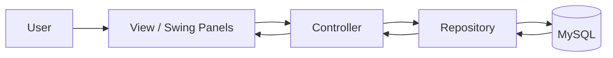

# StoreMate

StoreMate is a Java Swing point-of-sale desktop application for selecting products, calculating a checkout, recording sales, displaying a receipt, and reviewing date-range analytics.

## Features

- Search and category-filter product cards
- Add, quantity-change, remove, and clear checkout items
- Enter customer payment or use exact-cash and bill presets
- Calculate change and prevent underpayment
- Save orders and order items in one database transaction
- Display a receipt after a successful sale
- View revenue, order count, average order, and items sold
- View sales over time, category sales, and top-selling products
- Monitor database connectivity in the footer

## Technology Stack

| Technology | Purpose |
|---|---|
| Java 21 | Application language and records |
| Java Swing | Desktop UI |
| FlatLaf 3.7.2 | Look and feel |
| JFreeChart 1.5.4 | Analytics charts |
| MySQL / MariaDB | Persistent data |
| MySQL Connector/J 8.4.0 | JDBC database driver |
| Laragon | Recommended local MySQL environment |

Libraries are stored in `lib/` and registered in `StoreMate.iml` and [.vscode/settings.json](.vscode/settings.json).

## Project Structure

```text
StoreMate/
|-- src/
|   |-- app/                 Entry point and startup loading
|   |-- controller/          UI-event coordination and SwingWorker operations
|   |-- model/               Domain and report objects
|   |   `-- repository/      JDBC queries and transactions
|   |-- util/                Shared configuration and formatting helpers
|   `-- view/                Swing screens, components, and dialogs
|       `-- resources/       Database settings, fonts, images, and styles
|-- database/query.sql       Database and sample-data setup
|-- lib/                     Third-party JAR dependencies
|-- StoreMate.iml            IntelliJ module configuration
`-- .vscode/settings.json    VS Code Java configuration
```

## Setup

### 1. Requirements

- JDK 21
- MySQL or MariaDB
- IntelliJ IDEA or VS Code with Java support

### 2. Configure the database connection

The database configuration file is `src/resources/db.properties`. This file is excluded from version control and must be created locally if it is missing after downloading or cloning the project.

Create `src/resources/db.properties` with the following content, then update the username and password to match your local MySQL setup:

```properties
db.url=jdbc:mysql://localhost:3306/db_storemate?useSSL=false&allowPublicKeyRetrieval=true
db.user=root
db.password=
```

The blank password is only appropriate for a local MySQL setup configured that way. Do not commit real database passwords. `Database.java` reads these values and falls back to the same Laragon defaults if the file is absent.

### 3. Start MySQL and create the database

Start MySQL with Laragon or another local MySQL service. Open [database/query.sql](database/query.sql) in MySQL Workbench or a database console and execute it. It creates:

- `db_storemate`
- `categories`
- `products`
- `orders`
- `orders_item`
- Four categories and sample products

The script uses `INSERT IGNORE`, so rerunning it will not duplicate the default categories or products.

### 4. Run the application

Run `app.App.main(String[])`.

The startup sequence is:

1. Initialize the FlatLaf theme and custom fonts.
2. Start on the Swing Event Dispatch Thread.
3. Show the splash window.
4. Load products in a background `SwingWorker`.
5. Build repositories and controllers.
6. Open `MainFrame`.

## Database Design

### `categories`

| Column | Description |
|---|---|
| `id` | Primary key |
| `category_name` | Unique category name |
| `created_at` | Creation timestamp |
| `updated_at` | Last-update timestamp |

### `products`

| Column | Description |
|---|---|
| `id` | Primary key |
| `category_id` | Foreign key to `categories.id` |
| `product_name` | Unique product name |
| `price` | Sale price with two decimal places |
| `is_active` | Product availability flag |
| `image_path` | Optional product image filename/path |

### `orders`

Stores the order-level subtotal, total, customer payment, change, and timestamp.

### `orders_item`

Stores each purchased product. `price` and `line_total` preserve the sale-time values and keep historical sales accurate if product prices later change.

## Architecture

StoreMate uses a Swing-oriented MVC-style separation:



- **Model:** business/domain objects and repositories
- **View:** Swing components and presentation state
- **Controller:** event handling, validation coordination, and background database operations

`OrderController` implements `OrderPanel.Listener`; `AnalyticsController` implements `AnalyticsPanel.Listener`. These listener interfaces prevent the views from directly depending on repository or database classes.

## Core Data Flow

### Startup

`App` -> `AppInitializer` -> `StartupLoader` -> `ProductRepository.findAll()` -> `App.openMainWindow()` -> `OrderController` + `AnalyticsController` -> `MainFrame`

### Place an order

1. `ProductCard` reports a product selection.
2. `OrderPanel` forwards the event to `OrderController`.
3. `Order` adds the product or changes quantity.
4. `CheckoutPanel` displays items and totals.
5. `OrderController` validates received payment.
6. `OrderRepository.save(...)` opens a JDBC transaction.
7. It inserts `orders`, inserts all `orders_item` rows by batch, and commits.
8. Failure triggers rollback.
9. Success creates a `Receipt` and opens `ReceiptDialog`.

### Load analytics

1. `AnalyticsPanel` sends the selected dates to `AnalyticsController`.
2. `AnalyticsRepository.load(...)` opens one JDBC connection.
3. It returns summary, time-series, category, and top-product data.
4. `AnalyticsController` ignores obsolete requests and updates the view.

## Main Packages

| Package | Responsibility |
|---|---|
| `app` | Composition root and startup |
| `controller` | Application actions and asynchronous operations |
| `model` | `Product`, `Order`, `Receipt`, and `AnalyticsReport` |
| `model.repository` | JDBC connection, products, orders, and analytics |
| `view` | Main frame and screen navigation |
| `view.panels` | High-level Order, Checkout, Products, and Analytics screens |
| `view.components` | Reusable Swing components |
| `view.dialogs` | Receipt dialog |
| `util` | Theme, fonts, images, money, startup, and app metadata |

## Full Codebase Guide

See [docs/CODEBASE_GUIDE.md](docs/CODEBASE_GUIDE.md) for class-by-class responsibilities, OOP concepts, navigation, analytics behavior, threading, error handling, and presentation guidance.
